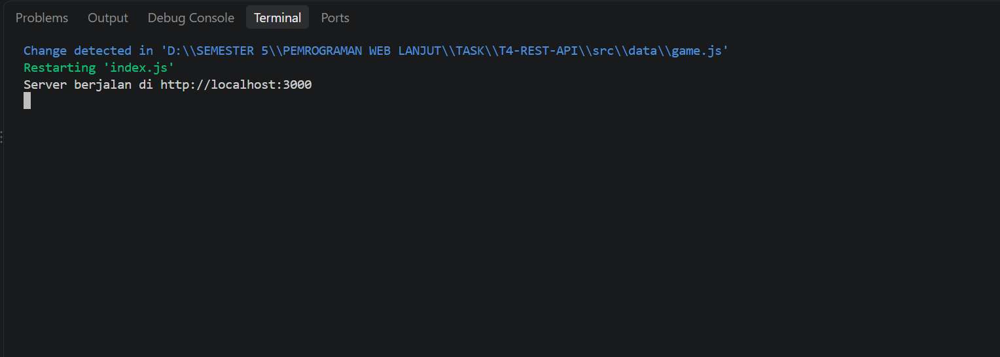
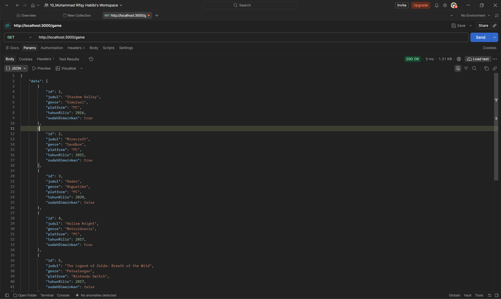
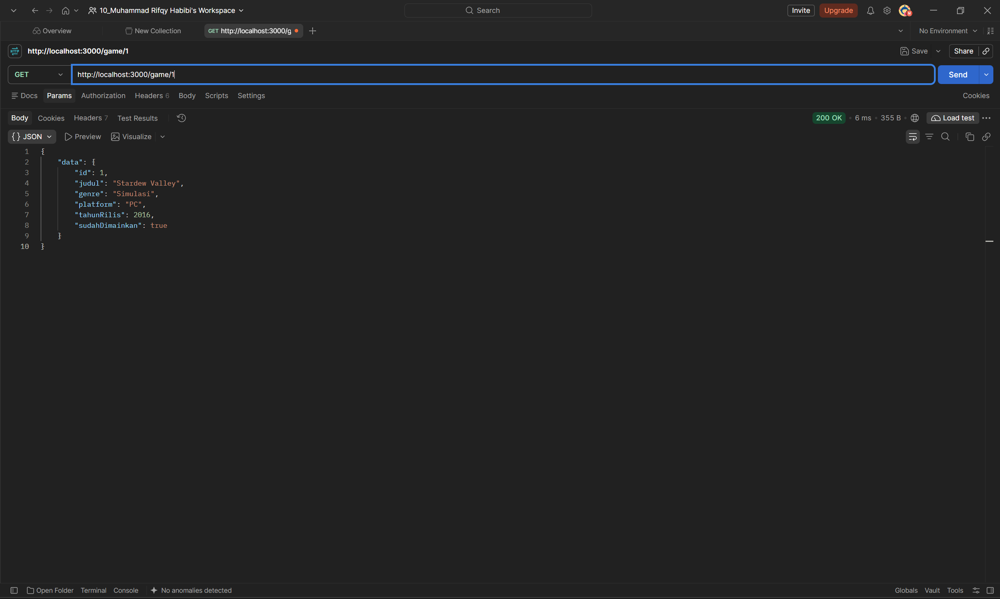
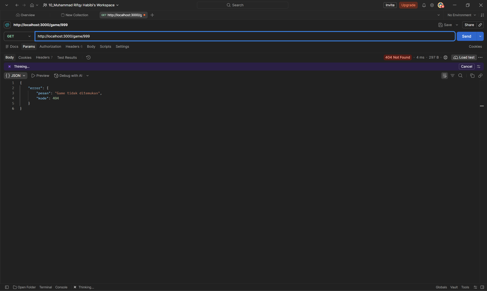
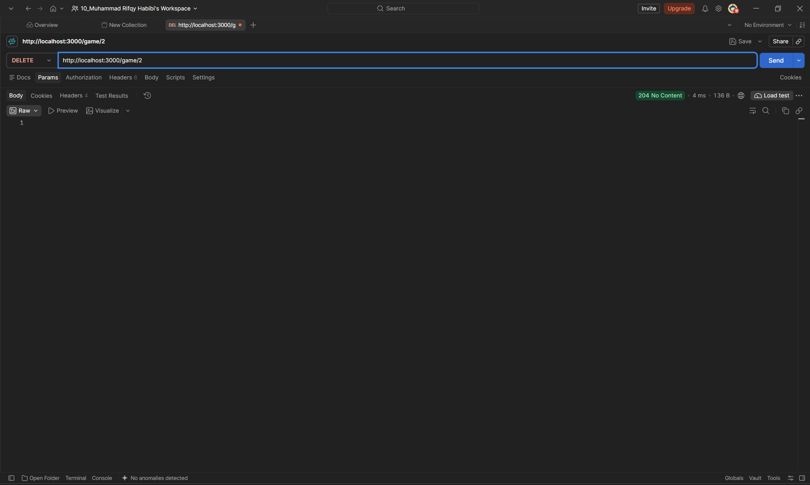
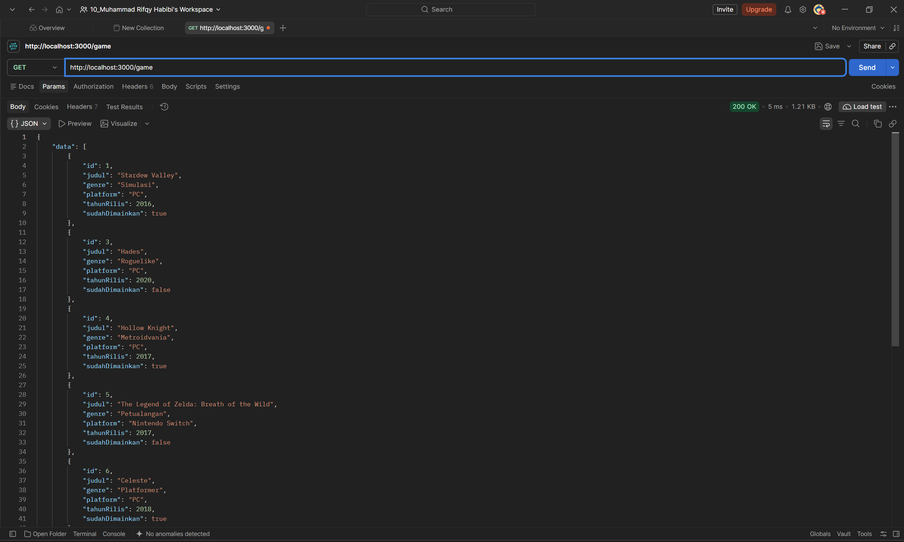

# Tugas 4 - REST API Dasar

## Identitas
- Nama: **Muhammad Rifqy Habibi**
- NIM: **F1D02410080**
- Program Studi: Teknik Informatika

## Deskripsi
Proyek ini menyediakan REST API sederhana menggunakan Express.js untuk mengelola daftar game. Data disimpan sebagai array object di `src/data/game.js`. Topik game dipilih agar informasi seperti genre, platform, tahun rilis, dan status pernah dimainkan dapat ditampilkan dalam satu resource.

## Teknologi
- Node.js
- Express.js
- JavaScript (ES Modules)

## Cara Menjalankan
1. Pastikan Node.js sudah terinstal.
2. Buka terminal pada folder proyek.
3. Jalankan `npm install`.
4. Jalankan `npm run dev`.
5. Akses API di `http://localhost:3000`.

## Daftar Endpoint

| Method | Endpoint | Fungsi | Status |
|---|---|---|---|
| GET | `/` | Menampilkan pesan sambutan | 200 |
| GET | `/game` | Menampilkan semua game | 200 |
| GET | `/game/:id` | Menampilkan detail game | 200 atau 404 |
| DELETE | `/game/:id` | Menghapus game dari data dalam memori | 204 atau 404 |

Response sukses dibungkus dengan properti `data`. Response gagal menggunakan `error` yang berisi `pesan` dan `kode`. Data yang dihapus akan kembali saat server dimulai ulang.

## Bentuk Data
Contoh satu item: `{ "id": 1, "judul": "Stardew Valley", "genre": "Simulasi", "platform": "PC", "tahunRilis": 2016, "sudahDimainkan": true }`.

- `id`: nomor unik game
- `judul`: nama game
- `genre`: kategori game
- `platform`: platform yang digunakan
- `tahunRilis`: tahun game dirilis
- `sudahDimainkan`: status apakah game sudah pernah dimainkan

Dataset berisi 10 item di `src/data/game.js`.

## Pengujian
Screenshot pengujian API game tersimpan di folder `screenshot/`:

- Server berjalan: 
- GET `/game` (200 OK): 
- GET `/game/1` (200 OK): 
- GET `/game/999` (404 Not Found): 
- DELETE `/game/2` (204 No Content): 
- GET `/game` setelah DELETE (200 OK, data berkurang): 

Screenshot DELETE menunjukkan status **204 No Content**. Screenshot GET setelah penghapusan menunjukkan daftar yang tinggal 9 data.

## Deklarasi Penggunaan AI

| Bagian | Alat AI | Dipakai untuk apa | Bagaimana saya memeriksa hasilnya |
|---|---|---|---|
| Data (`src/data/game.js`) | ChatGPT | Membantu menyusun contoh data game dan field-nya | Saya meninjau isi data dan memastikan ada 10 ID unik |
| Route (`index.js`) | ChatGPT | Membantu mengadaptasi route REST dari resource film menjadi game | Saya menjalankan server dan menguji GET, 404, serta DELETE |
| README | ChatGPT | Membantu menyusun dokumentasi awal | Saya mencocokkan instruksi dan endpoint dengan isi proyek |

**Contoh prompt:** “Bantu ubah proyek REST API Express resource film menjadi resource game dengan minimal 10 data, endpoint GET daftar/detail, DELETE opsional, dan dokumentasi README.”

Pernyataan: Saya menggunakan AI pada bagian yang tercantum di tabel dan akan memeriksa serta memahami kode sebelum mengumpulkannya.

## Kesimpulan dan Kendala
Melalui tugas ini saya mempelajari cara menyusun data sebagai array object, membuat endpoint REST dengan Express, mencari data menggunakan parameter ID, serta mengembalikan status HTTP yang sesuai. Salah satu hal yang perlu diperhatikan adalah `req.params.id` berupa string, sehingga nilainya dikonversi ke angka sebelum dibandingkan dengan ID pada data.
